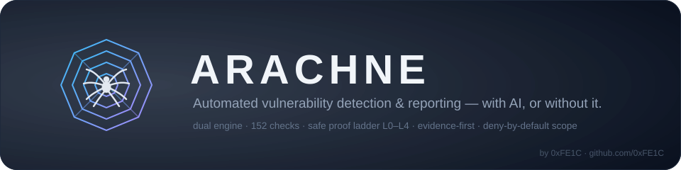
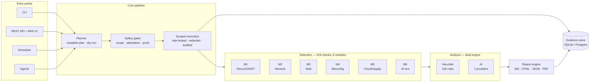
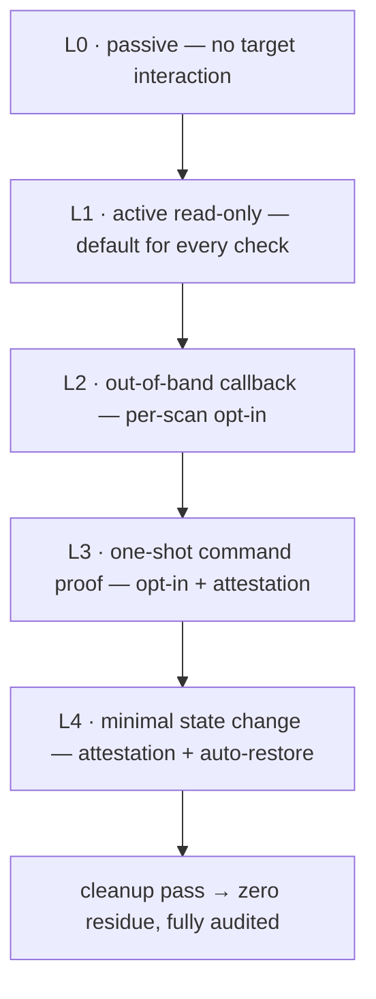

<p align="center"></p>

<h3 align="center"><b>Automated vulnerability detection &amp; reporting — with AI, or without it.</b></h3>

<p align="center">
  <a href="LICENSE"></a>
  
  
  
  
  
  
</p>

---

ARACHNE inspects targets you are **authorized** to test with attacker-grade methods,
proves what it finds through a graduated **safe proof ladder**, and produces
evidence-backed reports — then cleans up after itself. It runs on a **heuristic
engine** (deterministic, fully offline-capable), an **AI engine** (pluggable
providers), or both in parallel: a parity suite proves the two engines reach the same
findings on ground-truth labs.

> [!IMPORTANT]
> ARACHNE is a defensive tool. It detects and proves — it never exploits, persists, or
> destroys, and it is **refused by its own gates** unless every target is covered by an
> authorization attestation. Scanning systems you do not own is prohibited, by policy
> and by design.

> **Owner:** ARACHNE programme · **Last verified:** 2026-11-05 · **Review interval:** 180 days

## ✨ What makes it different

Most scanners stop at *"we think this is vulnerable."* ARACHNE is built to **prove**
it — safely — and to **show its work**:

| | Classic tools | ARACHNE |
|---|---|---|
| SQL injection | dumps the database | differential oracle + captured evidence, data stays yours |
| Blind RCE | drops a webshell | one-shot `echo arachne-<nonce>` proof — **nothing persists** |
| Findings | a list of alerts | **attack paths** with per-hop evidence and cheapest remediation |
| Trust | "trust the tool" | hash-chained audit, tamper-evident evidence, sealed integrity |
| State left behind | varies | a cleanup pass verifies **zero residue** |

## 📊 At a glance

| | |
|:---|:---|
| 🕷️ **419 registered checks** | 6 modules: recon/OSINT · network · web · misconfiguration · cloud/supply-chain · AI-era |
| 🪜 **Proof ladder L0–L4** | passive → read-only → out-of-band → one-shot command → minimal state change (auto-restored) |
| ⚙️ **Dual engine** | heuristic (127 rules, deterministic) + AI (7 provider adapters) — parity-guaranteed |
| 🖥️ **Run it your way** | CLI · REST API + web UI · scheduler · distributed agents · CI gate · air-gapped |
| 🧪 **5,882 tests** | incl. a 59-test safety suite and ground-truth labs with false-positive traps |
| 🔏 **Tamper-evident** | hash-chained audit trail; `arachne verify-chain` detects any modification |
| 🔑 **Asymmetric signing** | Ed25519 alongside HMAC — an auditor with only the public key verifies and cannot forge |
| 📋 **Generated compliance maps** | CIS · ISO 27001 · NIST CSF · PCI DSS, built from check metadata with the unassessed remainder named |

## 🏗️ Architecture



Every request passes through the scoped, rate-limited, redacting, audited HTTP client —
checks cannot reach a host outside the compiled scope even by bug, because they only
ever receive a scope-bound client.

## 🪜 The safe proof ladder

Each check declares how far it may go; the engine always chooses the **lowest
sufficient level**:



Escalation is never implicit: L2+ needs a per-scan opt-in, L3/L4 need a typed,
expiring **authorization attestation**, and any state change is captured, restored and
re-verified with every step in the audit trail.

## 🚀 Quick start

Python 3.11+ required. From the repository root:

```bash
python -m venv .venv
. .venv/bin/activate
pip install -e ".[dev]"
arachne --version        # → 0.1.0
```

A fresh install starts with an **empty database** and a **closed API** — you set
everything up explicitly:

```bash
arachne db upgrade                       # create the schema (empty state)
arachne scan --target examples/targets/lab-fixture.yaml --dry-run
                                         # readable plan — ZERO requests
arachne scan --target examples/targets/lab-fixture.yaml
                                         # live scan (documentation-range lab)
arachne report --scan 1 --format md --output report.md
arachne serve --host 127.0.0.1 --port 8080
curl http://127.0.0.1:8080/health
```

> [!TIP]
> Always start with `--dry-run`: it prints the complete plan — scope, attestation,
> every check with its proof level, estimated request count — without touching the
> network.

The example target points at documentation ranges (example.com, RFC 5737) and carries
a complete authorization attestation — see
[`examples/targets/lab-fixture.yaml`](examples/targets/lab-fixture.yaml) to write your
own.

## 📦 The six detection modules

| Module | Checks | What it covers |
|---|:---:|---|
| **M1** Recon & OSINT | 17 | dork sweeps, subdomains, certificate transparency, breach exposure, provider drift (Shodan/Censys) |
| **M2** Network & Services | 63 | ports, fingerprints, TLS & mTLS enforcement, DNS/AXFR, SMB and SSH auth, database & ICS probing, SMTP transport, HTTP/3 parity, read-only AD CS enumeration, CVE correlation, and the exposed-service breadth family (read-only probes of IPMI/Redfish, the container daemon API, etcd, Consul, Vault, ZooKeeper, Kafka, Elasticsearch, RabbitMQ, Jenkins, Grafana, Prometheus, Kibana, CouchDB, Redis and memcached) |
| **M3** Web Application | 162 | SQLi/XSS/SSRF/IDOR, command & template injection, XXE, smuggling, cache poisoning, GraphQL, JWT/OAuth/SAML, DOM-XSS in a headless browser, the WordPress and CMS-family-B (Joomla/Drupal/Moodle/PrestaShop/Magento) surface inventories, the application-server family (Spring Boot, Django, Rails, Laravel, Tomcat, JBoss, WebLogic, ColdFusion, IIS), and the API and modern-web surface (OpenAPI/Swagger documents and an unauthenticated declared operation, GraphQL introspection/suggestions/IDE, the browser-facing gRPC surface, WebSocket origin handling, serverless and edge-function endpoints, and CORS) |
| **M4** Misconfiguration | 77 | `.env`/`.git` exposure, backups, debug endpoints, headers, cookies, default credentials, and the source-control, CI and infrastructure artifacts (git reflog and credential stores, CI pipeline definitions and their secrets, Terraform state/plan/lock, cloud credential files, container and orchestration manifests, editor residue, credential and authorization files, environment-file variants), and the server, platform and runtime configuration defaults (nginx/Apache/IIS/Caddy default pages and configuration files, the machine-readable directory indexes, the Docker and Podman version endpoints, the orchestration and registry dashboards, the message-broker consoles, and the header, cookie and caching defaults) |
| **M5** Cloud & Supply Chain | 81 | IMDS/metadata, buckets, Kubernetes, registries, native image scanning, CI/CD, dependency confusion, IAM, DigitalOcean posture, the AWS read-only service posture family (S3, IAM, EC2 and instance metadata, RDS, EKS, Lambda, CloudTrail, KMS, SQS/SNS, ECR and the account-level defaults), and the Azure, GCP and Kubernetes read-only posture families (Azure storage, security groups, Key Vault, SQL, AKS and App Service; GCP object storage, GKE, IAM, Cloud SQL and functions; Kubernetes RBAC, secrets metadata, the API server, workloads, the dashboard, the kubelet and admission), each read with a vault-supplied credential |
| **M6** AI-era & Post-Exploit | 19 | webshell signatures, secret scanning, LPE, AD attack paths, GenAI surface, MCP security, the Agentic Top 10 surface, Sigma hunts |

*(+ distributed fuzzing, simulation, purple-team validation and remediation-as-code —
see [docs/architecture.md](docs/architecture.md))*

## 📚 Documentation

| Document | Purpose |
|---|---|
| 🟢 [docs/getting-started.md](docs/getting-started.md) | **Start here** — install → migrate → first scan → API, step by step |
| 🏗️ [docs/architecture.md](docs/architecture.md) | Pipeline, safety stack, proof ladder, dual engine, distributed mode — with diagrams |
| 📖 [docs/operator-guide.md](docs/operator-guide.md) | Deep reference: every variable, every command, runbooks |
| 🔌 [docs/plugin-developer-guide.md](docs/plugin-developer-guide.md) | Write your own checks, modules and report formats |
| 🔄 [docs/ci-integration.md](docs/ci-integration.md) | Use ARACHNE as a CI gate |
| 📊 [docs/reproducible-benchmark.md](docs/reproducible-benchmark.md) | The published benchmark: method, raw results, environment, rotation |
| 📦 [docs/slsa-provenance.md](docs/slsa-provenance.md) | Release provenance and the SBOM: what is claimed, and how to verify it |
| 🔏 [docs/security-review.md](docs/security-review.md) | Security review of the codebase itself |
| 🗂️ [docs/README.md](docs/README.md) | Full documentation index |

<details>
<summary><b>🗂️ Repository layout</b></summary>

```
ARACHNE/
├── src/arachne/        # core, modules m1–m6, analyzer, ai/, api/, report/, data/
├── tests/              # unit · safety · integration · parity · report-QA · labs
├── docs/               # getting-started, architecture, operator guide, ADRs, security
├── migrations/         # Alembic schema migrations
├── docker/             # Dockerfile + compose (demo stack, offline scan)
├── deploy/             # Helm chart + Terraform
├── clients/            # generated Python/TS API clients
├── examples/           # commented target definitions, plugins
└── benchmarks/         # benchmark harness suites
```

</details>

## 🤝 Contributing

Issues and pull requests are welcome. Plugin authors: start with the
[plugin developer guide](docs/plugin-developer-guide.md) — a new check rides the same
registry, versioning and safety gates as the built-in registry, whose size is the generated
count in [the badges above](#-at-a-glance) rather than a number typed here, and the parity
suite will hold it to the same bar.

## ⚖️ License

[MIT](LICENSE) © 2026 [0xFE1C (Felix)](https://github.com/0xFE1C). Third-party
components remain under their own licenses.

---

<p align="center">
  <sub><b>Red methods. Blue purpose. White evidence.</b> 🕷️<br>
  Scan only what you are authorized to test.</sub>
</p>
