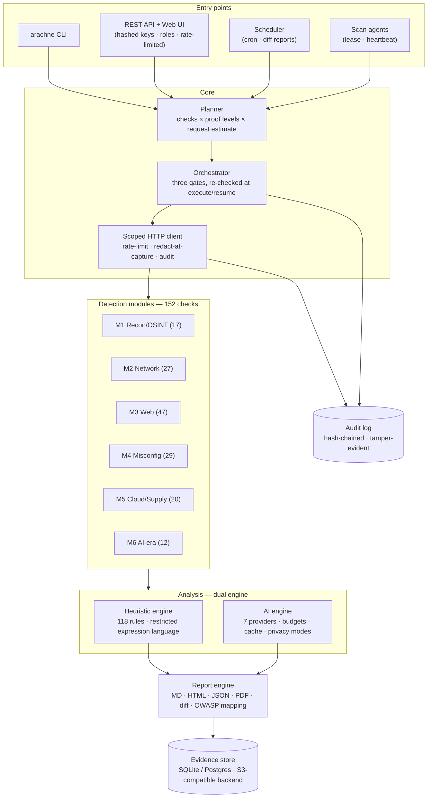
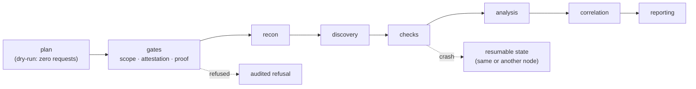
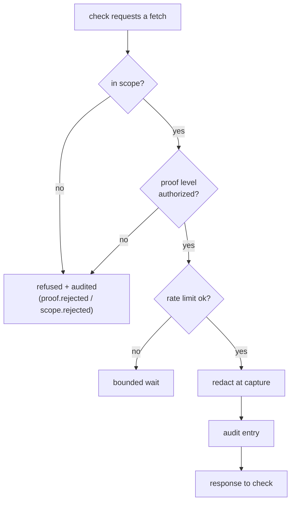
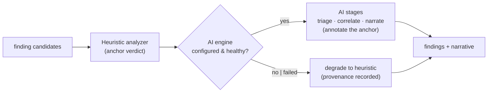
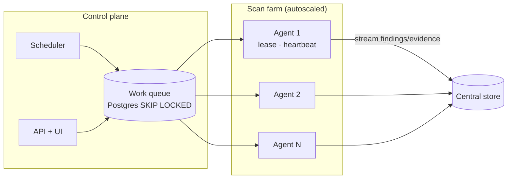

# Architecture

How ARACHNE works, with diagrams. For task-level instructions see
[getting-started.md](getting-started.md) and the
[operator guide](operator-guide.md); for the reasoning behind decisions see the
[ADRs](adr/).

## 1. System overview



**The one-sentence version:** entry points produce a *plan*; the orchestrator admits it
through three gates; checks run only through a scope-bound HTTP client; findings are
analyzed by the dual engine; everything lands in an evidence store with a sealed audit
trail.

## 2. Scan pipeline



- The **plan** is a first-class artifact: `--dry-run` prints the complete check list
  with proof levels and request estimates without touching the network.
- The **gates** (scope, attestation, proof) are evaluated at plan time *and* re-checked
  at execute/resume — an admitted scan cannot escalate after its attestation expires.
- A crashed scan leaves a **resumable state**; in distributed mode the lease expires
  and another agent re-leases it.

## 3. The safety stack

Four structural layers, each independent of operator discipline:

| Layer | Mechanism |
|---|---|
| **Scope** | Deny-by-default allowlist (hosts, domains, networks, URLs, references) + exclusions; DNS resolved and validated *before* each request; every redirect hop re-validated |
| **Attestation** | Typed, expiring, audited authorization records — required for active checks (L2+), purple-team windows, fuzzing |
| **Proof ladder** | L0 passive → L1 read-only → L2 out-of-band → L3 one-shot command → L4 minimal state change; always the lowest sufficient level; destructive SQL refused in code |
| **Audit** | Every request, refusal, gate decision and state change captured, redacted, hash-chained; `arachne verify-chain` detects tampering |



## 4. Dual engine with parity



The heuristic verdict is the anchor: the AI engine runs the heuristic first and
annotates, so an AI outage degrades quality — never the scan, never the safety. The
parity suite proves heuristic-only mode reaches the ground-truth labs' detection
thresholds.

## 5. Distributed mode



- One scan is leased by exactly one agent (`SKIP LOCKED`); a dead agent's lease
  expires and the scan is re-leased with an interruption note.
- Plans are deterministic: the same scan id produces the same plan on any node.
- Safety gates are evaluated on the **executing** node, not only at enqueue time.
- Air-gapped mode runs the full heuristic pipeline from signed offline content packs —
  zero external connectivity.

## 6. Where things live in code

```
src/arachne/
├── core/          # config, safety (Scope), http client, lifecycle, orchestrator,
│                  # planner, redaction, audit sink
├── modules/       # m1..m6 detection modules, registry (152 checks), handlers
├── analyzer/      # scoring, rules, correlation, FP tuning, narrative, remediation
├── ai/            # engine, stages, providers (7), budget, cache, privacy, reliability
├── report/        # builder, renderers (MD/HTML/JSON/PDF), diff, evidence, OWASP
├── api/           # FastAPI app, auth (hashed keys), rate limit, webhooks, UI
├── scheduler/     # cron parser, runner, store
├── data/          # SQLAlchemy stores: scans, findings, evidence, audit, feeds
└── plugins/       # entry-point plugin + content-pack installer
```

## 7. Design invariants

1. **Deny by default.** Empty scope authorizes nothing; every refusal is audited.
2. **Lowest sufficient proof.** Escalation is opt-in, attested, restored, audited.
3. **No exploitation.** No persistence, no destructive capability, no arbitrary
   command API for checks — enforced at code boundaries, not by convention.
4. **Heuristic independence.** The product runs fully without any AI provider (and
   fully offline in air-gapped mode).
5. **Everything is auditable and replayable.** AI decisions and proof actions are
   recorded; reports state what changed on a target and whether it was restored.
